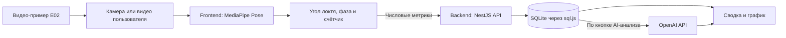

# ReMotion / SerIQ

**Прототип ИИ-помощника для домашней реабилитации верхней конечности после инсульта.** Проект помогает провести короткое занятие по разгибанию локтя, увидеть движение на камере и сохранить измерения для просмотра.

> Это исследовательский прототип, а не медицинское устройство и не замена рекомендациям врача или реабилитолога. Счётчик и ИИ могут ошибаться.

## Навигация

- [Проблема и идея](#проблема-и-идея)
- [Что умеет проект](#что-умеет-проект)
- [Как устроена система](#как-устроена-система)
- [Запуск](#запуск)
- [Как провести занятие](#как-провести-занятие)
- [Данные и обучение классификатора](#данные-и-обучение-классификатора)
- [Ограничения и дальнейшая работа](#ограничения-и-дальнейшая-работа)
- [Структура репозитория](#структура-репозитория)

## Проблема и идея

Домашние упражнения важно выполнять регулярно и в подходящем темпе. При этом человеку и специалисту бывает трудно вспомнить, сколько движений было сделано и как менялась амплитуда между занятиями. Обычная видеозапись сохраняет движение, но сама по себе не превращает его в понятную сводку.

ReMotion показывает пример упражнения рядом с камерой пользователя. Во время занятия приложение локально оценивает позу, рассчитывает угол локтя и ведёт простой счётчик сгибаний и разгибаний. Backend сохраняет числовые измерения, а по запросу ИИ формирует краткую техническую оценку занятия.

## Что умеет проект

- Показывает видео-пример упражнения E02 «Разгибание локтя» из предоставленного датасета.
- Поддерживает камеру или локально выбранное видео.
- Рисует скелет поверх видео пользователя и показывает оценку угла локтя.
- Считает движения по порогам угла и показывает длительность занятия.
- Сохраняет сессии и числовые измерения в локальной базе backend.
- Показывает историю, график измерений угла и результат по запросу к ИИ.
- Имеет интерфейс на русском и казахском языках.
- Содержит отдельный скрипт для воспроизводимой оценки классификатора на предоставленном датасете.

## Как устроена система



### Во время занятия

1. **Frontend** получает изображение с камеры или воспроизводит выбранный пользователем видеофайл.
2. **MediaPipe Pose Landmarker** работает в браузере и определяет ключевые точки тела. По точкам плеча, локтя и запястья вычисляется угол локтя.
3. **Счётчик** отмечает фазу «сгибание» при угле меньше 115° и засчитывает возвращение в фазу «разгибание» при угле больше 155°. Между повторами действует пауза 800 мс.
4. Примерно раз в полсекунды frontend отправляет в API числовые данные: текущий счётчик, угол, фазу и уверенность определения позы.
5. **Backend** сохраняет сессию и измерения в SQLite. Когда пользователь нажимает «AI-анализ», backend отправляет провайдеру только числовую сводку и временной ряд метрик.

Кадры камеры и пользовательское видео не отправляются в backend. Данные сессии хранятся локально в файле `backend/seriq.sqlite`. При включении AI-анализа метрики конкретного занятия передаются OpenAI API; для этого нужен ключ и исходящий доступ backend к интернету.

### Технологии

| Часть | Технологии |
| --- | --- |
| Интерфейс | Next.js, React, TypeScript, next-intl |
| Оценка позы | MediaPipe Tasks Vision, Pose Landmarker |
| Графики | Recharts |
| API | NestJS, TypeScript, Swagger |
| Хранение | SQLite через `sql.js`, TypeORM |
| Эксперимент с классификатором | Python, MediaPipe, scikit-learn |

## Запуск

### Требования

- Node.js 20.9 или новее и npm.
- Python 3.10–3.12 — только для повторного обучения и оценки классификатора.
- Браузер с поддержкой камеры. Для локальной разработки используй `localhost` или HTTPS.
- Ключ OpenAI API — только если нужен AI-анализ результатов. Без него камера, счётчик и сохранение сессий работают, но AI-анализ будет недоступен.

Frontend и backend запускаются отдельно, в двух терминалах.

### 1. Backend

Из корня репозитория в PowerShell:

```powershell
cd backend
Copy-Item .env.example .env
npm ci
npm run start:dev
```

Если файл `.env` уже существует, не перезаписывай его: добавь или проверь нужные значения вручную.

В `backend/.env` укажи ключ для AI-анализа:

```dotenv
PORT=8000
DATABASE_PATH=./seriq.sqlite
CORS_ORIGINS=http://localhost:3000,http://127.0.0.1:3000
OPENAI_API_KEY=твой_ключ
OPENAI_MODEL=gpt-6.2-sol
```

`OPENAI_API_KEY` не добавляй в Git и не помещай во frontend-файлы. После изменения `.env` перезапусти backend.

- API: <http://localhost:8000>
- Проверка состояния: <http://localhost:8000/api/health>
- Swagger: <http://localhost:8000/docs>

### 2. Frontend

В новом терминале из корня репозитория:

```powershell
cd frontend
Copy-Item .env.example .env.local
npm ci
npm run dev
```

Открой <http://localhost:3000/ru>. Для казахского интерфейса открой <http://localhost:3000/kk>.

В `frontend/.env.local` для подключения к API должны быть заданы:

```dotenv
NEXT_PUBLIC_API_URL=http://localhost:8000
NEXT_PUBLIC_DEMO_MODE=false
```

Примеры настроек уже лежат в `.env.example` обоих приложений. Если меняешь `NEXT_PUBLIC_*`, перезапусти frontend.

### Режим демо

Чтобы показать интерфейс без backend, установи `NEXT_PUBLIC_DEMO_MODE=true` в `frontend/.env.local` и перезапусти frontend. В демо-режиме показываются демонстрационные результаты; они не являются результатом обработки текущего видео.

## Как провести занятие

1. Открой страницу подготовки и разреши браузеру доступ к камере либо выбери видеофайл.
2. Расположись боком к камере; постарайся оставить плечо, локоть и запястье в кадре. Видео-пример E02 находится рядом.
3. Дождись, пока на изображении появится скелет, затем нажми **«Начать занятие»**.
4. Выполняй движения в удобном темпе, ориентируясь на инструкцию специалиста и видео-пример. Во время занятия видны камера, скелет, угол локтя и число засчитанных движений.
5. Нажми **«Завершить»**. В сводке отображаются показание счётчика, график измерений и сохранённая сессия.
6. Нажми **«AI-анализ»**, чтобы запросить общую техническую оценку занятия. Для этого backend должен иметь доступ к OpenAI API и настроенный ключ.

Счётчик основан на фиксированных порогах угла и может засчитать лишние или пропустить движения. Текущая сводка показывает измерения во времени; надёжной оценки качества каждого отдельного повтора в приложении пока нет.

## API

| Метод | Путь | Назначение |
| --- | --- | --- |
| `GET` | `/api/health` | Проверить, что API запущен |
| `GET` | `/api/exercises` | Получить список упражнений |
| `GET` | `/api/exercises/:exerciseId` | Получить описание упражнения |
| `POST` | `/api/sessions/start` | Создать сессию |
| `POST` | `/api/sessions/:id/metrics` | Сохранить числовые метрики движения |
| `POST` | `/api/sessions/:id/finish` | Завершить сессию и сохранить итог |
| `GET` | `/api/sessions/:id/results` | Получить результат и метрики |
| `GET` | `/api/sessions/history` | Получить историю занятий |
| `POST` | `/api/sessions/:id/analyze` | Запросить AI-анализ сохранённых метрик |

## Данные и обучение классификатора

Исходный датасет в репозиторий не включён. Получи папку `An upper limb stroke rehabilitation exercise video` из материалов задания и положи её в корень проекта. Скрипт использует только раздел упражнения `Exercise/2_Extending the Elbow` с подпапками `Complete` и `Incomplete`.

Из корня репозитория в PowerShell:

```powershell
python -m venv ml/.venv
ml/.venv/Scripts/python.exe -m pip install -r ml/requirements.txt
ml/.venv/Scripts/python.exe ml/train_e02.py
```

Первый запуск скачивает MediaPipe Pose Landmarker Lite в `ml/models/`. Если датасет лежит в другом месте:

```powershell
ml/.venv/Scripts/python.exe ml/train_e02.py --dataset "D:\data\An upper limb stroke rehabilitation exercise video"
```

Скрипт извлекает последовательности углов локтя, выбирает модель на групповой кросс-валидации по участникам внутри Train и один раз проверяет результат на отложенном Test. Идентификатор участника берётся из префикса имени файла. Для этого разделения Train содержит участников `01`–`05`, Test — участника `08`; пересечения между Train и Test нет.

Результаты текущего эксперимента:

| Подход | Balanced Accuracy | F1 |
| --- | ---: | ---: |
| Sequence-классификатор Extra Trees | 0,30 | 0,36 |
| Базовый алгоритм по порогам угла | 0,45 | 0,62 |

Тест содержит 20 видео только одного участника, поэтому оценка предварительная и плохо отражает работу на новых людях. Текущий классификатор проиграл базовому алгоритму и **не подключён к живым занятиям**. Его нельзя трактовать как надёжный классификатор реабилитационных упражнений.

Сгенерированные подробные файлы сохраняются в игнорируемую папку `ml/artifacts/`: метрики, предсказания по тестовым видео, признаки и JSON-модель. Краткая сводка для страницы «Технологии» записывается в `frontend/src/data/e02-evaluation.json`.

Подробности эксперимента и команды приведены в [ml/README.md](ml/README.md).

## Ограничения и дальнейшая работа

- Счётчик повторов использует пороги угла, а не обученную модель движения; результат зависит от положения относительно камеры и видимости руки.
- AI-анализ получает числовые метрики, а не видеозапись, и выдаёт общую оценку сессии. Это не оценка каждого повтора и не медицинское заключение.
- Экспериментальный классификатор показал слабый результат на тестовой выборке из одного участника и не используется в занятии.
- Для содержательной оценки нужны данные от большего числа участников, проверка на независимых участниках и отдельная валидация каждого цикла.
- Датасет и видео участников не хранятся в GitHub-репозитории. Для воспроизведения обучения их нужно получить отдельно.

## Структура репозитория

```text
backend/                         NestJS API, AI endpoint, локальная SQLite-база
frontend/                        Next.js приложение
  public/videos/                 Видео-пример упражнения E02
  src/components/camera/         Подготовка камеры и видеоинструкция
  src/components/session/        Экран занятия, сводка и история
  src/lib/pose-detection.ts      MediaPipe, угол локтя и счётчик
ml/                               Скрипт обучения и оценки E02
  train_e02.py
  requirements.txt
```

Локальные `.env`, база SQLite, исходный датасет, пользовательские видео, виртуальное окружение Python и подробные артефакты обучения исключены из Git.

## Документация

- [Контракт frontend и backend](frontend/FRONTEND_API_CONTRACT.md)
- [Документация frontend](frontend/README.md)
- [Эксперимент с датасетом E02](ml/README.md)
